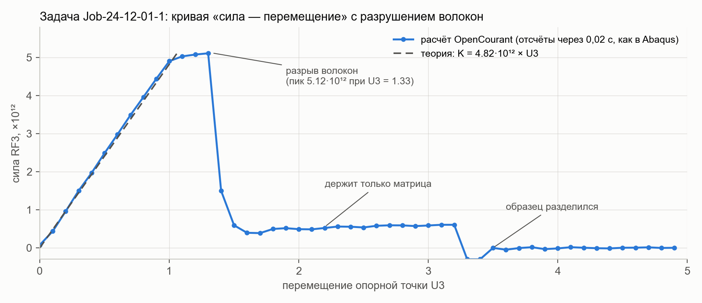

# Серия расчётов композита без лицензии Abaqus: OpenCourant + Apptainer на Linux

Методика запуска подготовленных в Abaqus/CAE задач (`.inp`) на **бесплатном открытом
решателе OpenCourant** (бывший OpenRadioss, явная динамика — аналог Abaqus/Explicit)
в контейнере Apptainer. Лицензии не нужны. Проверено от начала до конца на чистой
машине Rocky Linux 8 от имени обычного пользователя на задачах серии `24-12-02`.

**Новое:** в расчёт добавлено хрупкое разрушение углеродных волокон (как в Abaqus):
кривая «сила — перемещение» — прямая, пик, обрыв; раньше образец «тянулся». См.
[Чем расчёт отличается от Abaqus](#чем-расчёт-отличается-от-abaqus--читать-обязательно).

Подробная методичка со скриншотами каждого шага — [docs/Методичка_OpenCourant.docx](docs/Методичка_OpenCourant.docx).

---

## Что нужно

| | |
|---|---|
| Компьютер | Linux, процессор x86-64 (обычный сервер/ПК) или ARM64 |
| Программы | `apptainer` и `git` — **больше ничего** (Python и решатель — внутри образа) |
| Ядра / память | чем больше ядер, тем быстрее; памяти хватает 4 ГБ |
| Диск | ~100 МБ на задачу (входной файл 45 МБ + результат ~45 МБ) + образ 170 МБ; 40 задач — ~4 ГБ |
| Время | установка 5 мин; одна задача ~10 мин на 16 ядрах; 40 задач — ~7 ч |
| Интернет | нужен для шагов 1–2 (GitHub и Яндекс.Диск) |

Нет Linux? Подойдёт виртуальная машина или WSL2 в Windows (`wsl --install -d Ubuntu`),
дальше всё так же.

## Шаг 0. Apptainer и git (один раз, нужны права администратора)

Проверьте: `apptainer --version` и `git --version`. Если какой-то команды нет:

```bash
# Rocky / AlmaLinux / RHEL / CentOS
sudo dnf install -y epel-release && sudo dnf install -y apptainer git
# Ubuntu / Debian
sudo add-apt-repository -y ppa:apptainer/ppa && sudo apt update && sudo apt install -y apptainer git
```

Прав администратора нет — попросите администратора выполнить эту команду.

## Шаг 1. Проект и решатель

```bash
git clone https://github.com/Nev1x/abaqus-apptainer.git
cd abaqus-apptainer
opencourant/setup.sh
```

`setup.sh` скачивает официальный образ OpenCourant (версия зафиксирована), проверяет
контрольную сумму и пробный запуск. Должно закончиться так:

```
[setup] контрольная сумма совпала: ...
[setup] готово: OpenCourant latest-20261011 (linux64), образ: .../opencourant/image/OpenCourant_linux64.sif
[setup] внутри: mpirun (Open MPI) 4.1.2, Python 3.9.25
```

Если появится строка `образ не монтируется (нет FUSE) — распаковываю в каталог` —
так и задумано, скрипт сам подстраивается под сервер.

Дальше весь путь показан **на примере одной задачи** `Job-24-12-01-1.inp`; остальные
задачи — по аналогии (шаг 5).

## Шаг 2. Файл задачи

Откройте https://disk.yandex.ru/d/nR2yRT3GM2aCyg и скачайте из корня папки файл
`Job-24-12-01-1.inp` (42,8 МБ). Для каждой задачи там лежит по 15 файлов — `.odb`,
`.abq`, `.msg` и т. п. — это результаты старого расчёта Abaqus, они не нужны: нужен
только `.inp`. Положите файл в папку `inputs` проекта, без подпапок:

```bash
mkdir -p inputs
```

```
abaqus-apptainer/
└── inputs/
    └── Job-24-12-01-1.inp
```

Если сервер удалённый — скачайте файл на свой компьютер и перенесите:
`scp Job-24-12-01-1.inp <логин>@<сервер>:~/abaqus-apptainer/inputs/`.

## Шаг 3. Расчёт (~10 минут на 16 ядрах)

```bash
opencourant/run_job.sh inputs/Job-24-12-01-1.inp
```

```
[1/6] убираю обёртку Part/Assembly (tools/flatten_inp.py)
[2/6] перевожу Abaqus .inp в формат OpenCourant (inp2rad)
[3/6] дописываю то, что конвертер теряет: разрушение волокон, пластичность матрицы (tools/patch_rad.py)
[4/6] starter: проверка модели и разбиение на 18 доменов
[5/6] engine: расчёт на 18 ядрах ...
[6/6] извлекаю кривую RF3(U3) и чищу временные файлы
готово за 540 с: .../results/Job-24-12-01-1/curve.csv
```

Ход расчёта в другом окне: `opencourant/status.sh` или
`tail -f results/Job-24-12-01-1/engine.log` (`T=` — модельное время от 0 до 1).

## Шаг 4. Результат задачи

В папке `results/Job-24-12-01-1/`: `curve.csv` — кривая (время, перемещение U3, сила RF3);
`job.meta` — паспорт расчёта (версия решателя, контрольные суммы входного файла и образа,
время, число шагов); `STATUS` = `DONE`.



До U3 ≈ 1 — прямая (жёсткость совпадает с правилом смесей с точностью 2 %); при
U3 ≈ 1,33 волокна рвутся (пик 5,12·10¹²), сила падает до ~0,5·10¹² — держит только
матрица, — и при U3 ≈ 3,3 образец разделяется полностью.

## Шаг 5. Остальные задачи — по аналогии

Скачайте файлы `.inp` остальных нужных задач (до 40), положите в ту же папку `inputs` и
запустите одну команду — она пройдёт по всем файлам в `inputs` и соберёт общий отчёт:

```bash
nohup opencourant/run_all.sh > run_all.log 2>&1 &
tail -f run_all.log          # смотреть ход; Ctrl+C закрывает только просмотр
opencourant/status.sh        # таблица: какие задачи готовы
```

`nohup` — расчёт продолжится, даже если закрыть терминал или отключиться от сервера.
Задачи считаются по очереди (~10 мин каждая на 16 ядрах, 40 задач — около 7 ч);
готовые пропускаются, поэтому после прерывания достаточно запустить команду снова.
Только часть задач: `opencourant/run_all.sh inputs/Job-24-12-01-{1..4}.inp`.

Итог — в папке `report/`: `summary.csv` (таблица по задачам: модуль волокна, жёсткость —
расчёт и правило смесей, прочность `F_max` и перемещение разрыва `U_at_Fmax`, остаточная
сила матрицы `F_at_U2`), `curves.svg` и `stiffness.svg` (графики,
открываются в браузере). Пересобрать отчёт: `opencourant/report.sh`.

## Проверка под ключ: две задачи

Чтобы не нагружать сервер, методика с разрушением проверена на задачах 1 и 2 (модуль
волокна 231 и 237 ГПа); остальные отличаются только этим числом:
`opencourant/run_all.sh inputs/Job-24-12-01-{1,2}.inp`.

| Задача | Модуль волокна, ГПа | Жёсткость K, расчёт, ×10¹² | K по правилу смесей, ×10¹² | Расхождение | Прочность F_max, ×10¹² | U3 при разрыве | Время, с |
|---|---|---|---|---|---|---|---|
| 1 | 231 | 4,93 | 4,82 | +2,1 % | 5,12 | 1,33 | 540 |
| 2 | 237 | 5,05 | 4,95 | +2,1 % | 5,12 | 1,31 | 568 |

Сравнение с Abaqus (кривые преподавателя) и с разрывной машиной (232 образца):

| | OpenCourant | Abaqus | Разрывная машина |
|---|---|---|---|
| Форма кривой | прямая → пик → обрыв | прямая → пик → обрыв | прямая → пик → обрыв |
| Пик силы | 5,12·10¹² | ≈ 4,9–5,0·10¹² | — |
| Разрыв | U3 ≈ 1,3 (деформация 2,6 %) | U3 ≈ 1,15–1,25 (2,3–2,5 %) | 1,1–3,4 %, в среднем 1,8 % |
| После разрыва | матрица ~0,5·10¹², разделение при U3 ≈ 2,6–3,3 | матрица ~0,3·10¹² до конца | сила падает до нуля |

Графики: [report/curves.svg](report/curves.svg), [report/stiffness.svg](report/stiffness.svg).

## Чем расчёт отличается от Abaqus — читать обязательно

1. **Разрушение волокон переносится скриптом.** Конвертер `inp2rad` молча пропускает
   `*Damage Initiation, criterion=DUCTILE`. `tools/patch_rad.py` дописывает его как
   `/FAIL/JOHNSON` с тем же порогом (пластическая деформация 1,5 %) и удалением
   разрушенных элементов. Затухание повреждения (`*Damage Evolution`, 0,015) не
   переносится — элемент удаляется сразу, разрушение чуть «резче», чем в Abaqus.
2. **Пластичность матрицы.** Для полисульфона в `*Plastic` одна строка; `inp2rad` пишет
   кривую текучести из одной точки, и решатель удалял матрицу в начале расчёта (в прошлой
   версии методики это занижало жёсткость на ~1,5 %). `patch_rad.py` добавляет вторую
   точку — идеальная пластичность, как в Abaqus.
3. **Вырожденные элементы.** После разрыва волокон соседние элементы матрицы
   выворачиваются; элемент, чей шаг по времени упал ниже 2·10⁻⁶ с, удаляется
   (`/DT/BRICK/DEL`, параметр `DT_DEL`). Поэтому матрица в OpenCourant в итоге рвётся
   полностью, а в Abaqus держит до конца. Отдельные отсчёты в момент полного разделения
   — численный шум; прочность в отчёте берётся как пик до первого обрыва силы.
4. **Коэффициент шага по времени** 0,9 вместо 1,5 у Abaqus (`*Dynamic, Explicit, scale
   factor=1.5`): шагов больше, расчёт устойчивее.
5. Кривые Abaqus из `.odb` без Abaqus прочитать нельзя; сравнение — с кривыми из
   материалов преподавателя и с испытаниями на разрывной машине.

## Найденная ошибка в исходной модели

В рассчитанных задачах 1–4 27 «наборов волокон» (`_PickedSet3 … _PickedSet29`) содержат **одни и
те же элементы 1–83200 — все волокна сразу**. Каждое следующее назначение секции в CAE
перезаписывало предыдущее, и в `.inp` осталась только последняя: **все волокна получают
материал `Carbon27`**. Значит, из 27 «случайных» модулей на расчёт влияет только один
(`Carbon27`, 25 разных значений от 200 до 237 ГПа по задачам). Серия фактически
исследует зависимость отклика от одного модуля, одинакового для всех волокон.
Модели 2–40 — копии `Model-1`, в журнале CAE `archive/24-12-02.jnl` у них меняются только
материалы, поэтому ошибка есть во всех 40 задачах. Следствие для разрушения: все волокна
рвутся одновременно, одним обрывом; поочерёдное разрушение волокон с разными модулями
появится только после исправления модели. Исправлять надо в CAE: каждому волокну — свой набор элементов. Проверить:
`grep -A1 "_PickedSet[0-9]*, internal, generate" inputs/Job-24-12-01-1.inp`.

## Неполадки

| Сообщение / симптом | Что сделать |
|---|---|
| `не удалось прочитать историю modelT01` (версии до 09.11.2026 на x86-64: конвертер в образе называется `th_to_csv_linux64_gf`) | `git pull && opencourant/setup.sh`, затем **ту же** команду `opencourant/run_job.sh inputs/<задача>.inp` — если расчёт (engine) уже завершился, скрипт не пересчитывает, а продолжает с шага 6 (несколько секунд) |
| упал любой другой шаг | исправить причину по журналу из сообщения и повторить ту же команду; `FORCE=1` — пересчитать задачу с нуля |
| расчёт идёт часами, а не ~10 мин | в конце `results/<задача>/engine.log` есть таблица `CPU USER TIME`: большой столбец `IO` — медленный диск (виртуальная машина, сетевая папка) — держите проект на локальном диске; большой `ELEMENT` — медленные или логические ядра — задайте число физических ядер: `NP=8 opencourant/run_job.sh …` |

## Как это устроено

```
inputs/*.inp ──► flatten_inp.py ──► inp2rad (из образа) ──► patch_rad.py ──► starter ──► engine (MPI) ──► th_to_csv ──► curve.csv
  (Abaqus)        убрать Part/          перевод в формат      разрушение,      проверка,     расчёт          история        ──► report/
                  Assembly              OpenCourant (.rad)    пластичность     разбиение                     в CSV
```

| Файл | Назначение |
|---|---|
| `opencourant/setup.sh` | шаг 1: скачать и проверить образ решателя |
| `opencourant/run_job.sh` | шаг 3: одна задача от `.inp` до кривой |
| `opencourant/run_all.sh` | шаг 5: задачи по очереди + отчёт |
| `opencourant/status.sh`, `report.sh` | состояние задач; пересборка отчёта |
| `tools/flatten_inp.py` | убирает обёртку Part/Assembly (конвертер её не понимает) |
| `tools/patch_rad.py` | дописывает то, что конвертер теряет: разрушение волокон, пластичность матрицы |
| `tools/oc_results.py` | кривая из истории; аналитическая оценка (правило смесей) |
| `tools/tk_stub/` | заглушка `tkinter`, чтобы конвертер работал без графики |
| `archive/` | журнал CAE и исходные скрипты серии 24-12-02 |

Вариант с лицензионным Abaqus (контейнер Abaqus, Windows, Slurm) — в
[docs/README_Abaqus.md](docs/README_Abaqus.md); для основной методики не нужен.
